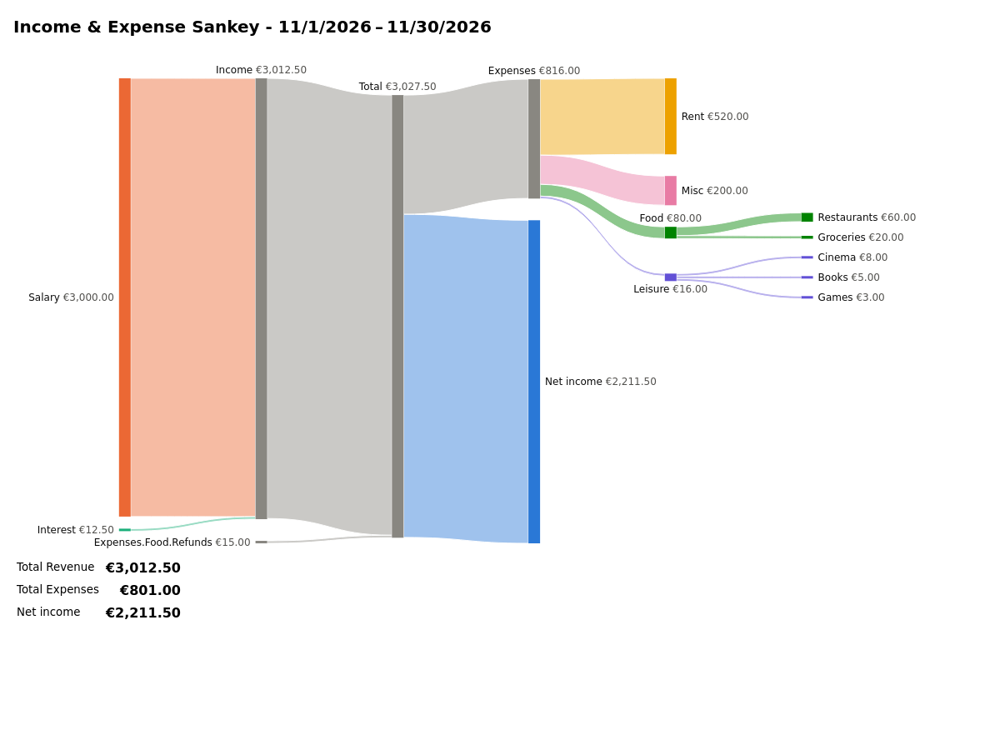
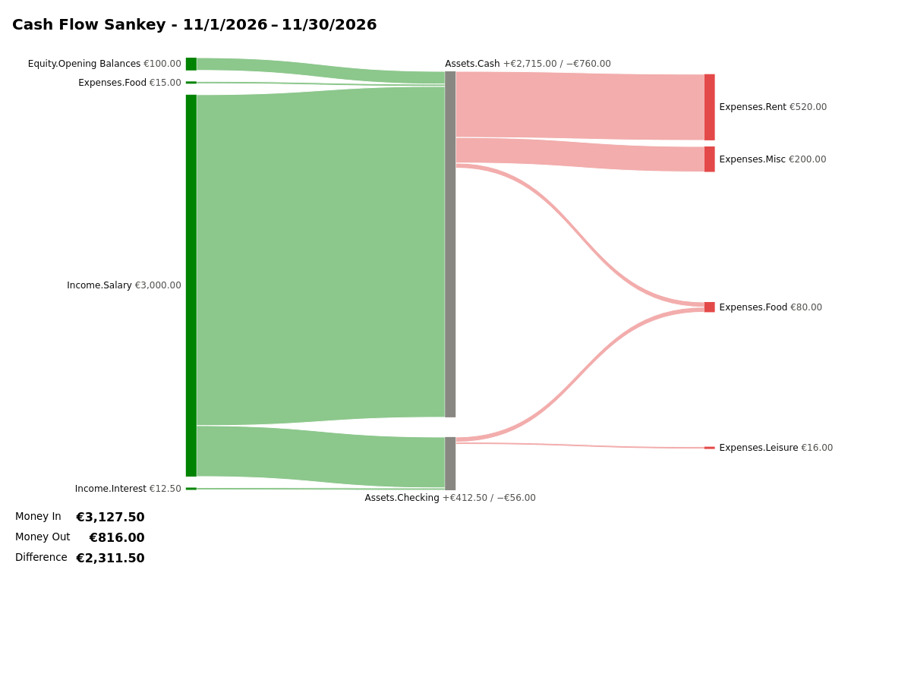
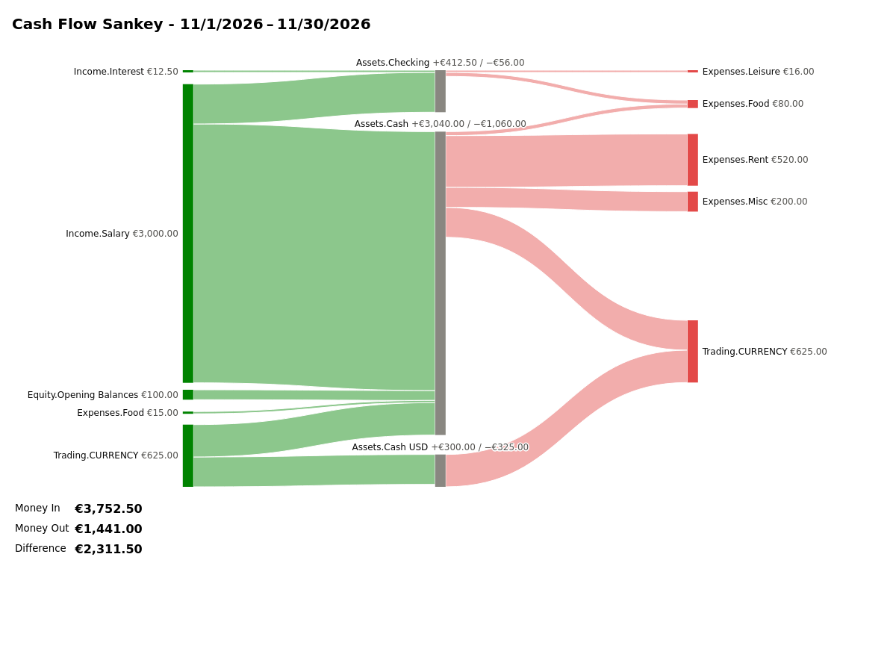

# gnucash-reports

Two reports for GnuCash desktop 5.16 that draw Sankey diagrams, under **Reports > Income & Expense**:

- **Income & Expense Sankey**: the numbers of the standard *Income Statement*.
- **Cash Flow Sankey**: the rules of the standard *Cash Flow* report, split by selected account.

They are Guile Scheme files that GnuCash loads at start. The diagram is plain SVG, without JavaScript, so it
works in the old browser engine of the Windows build, prints, and survives *Export as HTML*. Design decisions:
[ADR-0011](../docs/adr/0011-sankey-reports-in-gnucash-desktop.md),
[ADR-0012](../docs/adr/0012-sankey-label-options-fixed-colours-one-day-default.md).

## Screenshots

These are the test baselines: the reports run on an enriched copy of the sample book and rendered by Firefox,
not by the GnuCash window. They change whenever the baselines are refreshed, so they always show the current
drawing.

Income & Expense Sankey:



Cash Flow Sankey with the default options (trading accounts hidden):



Cash Flow Sankey with *Include Trading Accounts in report* on, where a currency exchange shows as money in
from and out to the trading account:



## Install

1. Copy the reports into GnuCash's user data folder (`%APPDATA%\GnuCash` on Windows,
   `~/.local/share/gnucash` on Linux). Either from the repository:

   ```
   ./mvnw -pl gnucash-reports -am install -Pinstall-desktop
   ```

   (add `-Dgnucash.userdata=<folder>` for a folder other than `%APPDATA%/GnuCash`), or by unpacking
   `gnucash-reports-<version>.zip` from a release there. Both leave a folder `gnucash-tools-reports` in it.

2. Once, add this line to `config-user.scm` in GnuCash's config folder (`%APPDATA%\GnuCash` on Windows,
   `~/.config/gnucash` on Linux); create the file if it does not exist:

   ```scheme
   (load ((@ (gnucash core-utils) gnc-build-userdata-path) "gnucash-tools-reports/load.scm"))
   ```

   Maven never touches this file.

3. Restart GnuCash.

To update, repeat step 1. To remove, delete the line and the folder.

Updating from a release made in the `fincore` repository: the folder was called `fincore-reports` then. Delete it,
and in `config-user.scm` change `"fincore-reports/load.scm"` to `"gnucash-tools-reports/load.scm"`.

## How the numbers are defined

### Income & Expense Sankey

Income accounts on the left flow through their parents into one hub; the hub pays the expense accounts on the
right; what is left is **Net income**. The table below the diagram shows Total Revenue, Total Expenses and Net
income exactly as the Income Statement computes them for the same options.

- An account's amount is its splits in the period minus those of closing entries (the *Closing Entries pattern*).
- Accounts deeper than *Levels of Subaccounts* count into their ancestor at that level.
- A parent's own postings make the parent wider than its children together.
- A **net loss** is a node on the left feeding the hub.
- An amount against its side's direction, such as an expense account with net refunds, cannot be drawn as a
  negative flow. It appears on the other side, attached to the hub under its full account name, and the hub
  is labelled *Total* instead of *Revenue*. Net income does not change.
- Trading accounts take part only when selected, as in the Income Statement, and are attached to the hub.

### Cash Flow Sankey

Left: where money came from. Middle: the selected accounts. Right: where money went. Money In, Money Out and
Difference below the diagram equal the Cash Flow report's for the same options.

- What counts is decided as in the standard report: every split of a transaction that touches a selected
  account, except splits in selected accounts themselves. Transfers between selected accounts are therefore
  not shown, and a middle node's in and out need not match. A middle node's label reads `+in / −out`.
- *Include Trading Accounts in report* does what its name says: **off** (the default) leaves the trading splits
  out, so a currency exchange between two selected accounts is a hidden transfer; **on** shows them as money
  in from and out to the trading account. The standard Cash Flow report (GnuCash 5.16) does the opposite, so
  this report with the option off has the totals of the standard report with it on, and vice versa.
- When a transaction touches several selected accounts, each counter split is shared between the selected
  splits of the opposite sign in proportion to their values (between all of them if none has the opposite
  sign).
- Unlike the standard report, *Account Display Depth* groups the accounts on the left and right: an account
  deeper than the depth is drawn as its ancestor at that depth.

### Options added to the standard ones

Both reports open on **one day, today**: GnuCash runs a report as soon as it is opened, and a long period on a
large book takes long. Choose the period in *Options > General*.

| Option (Display tab) | Default | Meaning |
|---|---|---|
| Minimum share (%) | 1 | Accounts below this share of the total are merged into *Other* (per parent). 0 shows all. |
| Width | 1100 | Width of the diagram in pixels. |
| Height | 600 | Height in pixels. The diagram grows when the accounts do not fit. |
| Show account names | on | Off: account nodes show their amount only. The hub, *Net income*/*Net loss* and *Other* keep their names. |
| Show Full Account Names | off (Income & Expense), on (Cash Flow) | Names with their parent accounts. |
| Show balances | on | Off: no node shows an amount. |
| Sub-account colours | Same as parent | How accounts below the first level are coloured; see below. |

Hover texts always show name and amount, whatever the options.

### Colours

Income is green and expenses red: in the Income & Expense Sankey the first level on each side, everything else
that feeds the hub from the income side (refunds, trading gains), and the net result (*Net income* green,
*Net loss* red); in the Cash Flow Sankey the sources on the left green and the targets on the right red. The
hub is grey. *Sub-account colours* decides the rest:

- **Same as parent**: deeper accounts take their side's green or red. In the Cash Flow Sankey the selected
  accounts are grey and each ribbon is green coming in and red going out.
- **Gray**: deeper accounts (Cash Flow: the selected accounts and the ribbons) are grey.
- **Distinct colours**: each second-level account (Cash Flow: each selected account), largest first, gets its
  own colour, never green or red; accounts below it and its ribbons share it. Income and expenses share one
  sequence of six colours, which starts over when used up.

Hover over a node or ribbon for its full name and amount; a name is cut in its label only when there is no room
for it anywhere near the node.

How the diagram is laid out: nodes stand near the nodes they are linked to; within a column they keep their
order (largest first, children by their parents) unless another order lets fewer ribbons cross; small amounts
are drawn at least 3 pixels thick, so a node or ribbon can look larger than its share. The labels and the
totals always show the true amounts.

## Development

```
./mvnw verify                                   # all modules; needs Docker
./mvnw -pl gnucash-reports -am verify           # this module and what it needs
./mvnw -pl gnucash-reports package              # target/gnucash-reports-<version>.zip
```

| Path | What |
|---|---|
| `src/main/scheme/gnucash-tools-reports/sankey-svg.scm` | Layout and drawing, pure Guile. |
| `src/main/scheme/gnucash-tools-reports/income-expense-sankey.scm`, `cash-flow-sankey.scm` | The reports. |
| `src/main/scheme/gnucash-tools-reports/load.scm` | Loads the three files; the only file `config-user.scm` names. |
| `src/test/scheme/sankey-svg-test.scm` | Layout tests in Guile (SRFI-64), run inside the image by `SankeyLayoutTest`. |
| `src/test/java` | Tests that run GnuCash on copies of `gnucash-book`'s sample book. |
| `src/test/resources/gnucash-config` | The test user data folder: `config-user.scm` and saved report configurations with fixed dates. |
| `src/test/resources/baselines` | Expected SVG and PNG of each rendered report. |
| `docker/Dockerfile` | The test image: GnuCash 5.16 command line, Guile, Firefox. |

### The test image

The tests run GnuCash in the image named by the property `gnucash.image` in `pom.xml`. CI publishes it; to
build it locally:

```
docker build -t ghcr.io/imolcean/gnucash-headless:5.16-1 gnucash-reports/docker
```

When the Dockerfile changes, raise the revision at the end of the tag in `pom.xml` and refresh the baselines.

### Baselines

`ScreenshotTest` compares the diagram's SVG text exactly and a Firefox screenshot of the page within a small
tolerance. What a run rendered is in `target/sankey`. After an intended change:

```
./mvnw -pl gnucash-reports -am verify -Dsankey.baselines.update=true
```

then look at the new PNGs in `src/test/resources/baselines` before committing them.

### Releases

A tag `gnucash-reports/v1.2.3` makes `.github/workflows/gnucash-reports-release.yml` run the tests and attach
`gnucash-reports-1.2.3.zip` to a GitHub release.

### Not covered by tests

How the diagram looks inside the GnuCash window on Windows (WebKitGTK 2.4.11), and the result on a real book.
Check both after installing.
