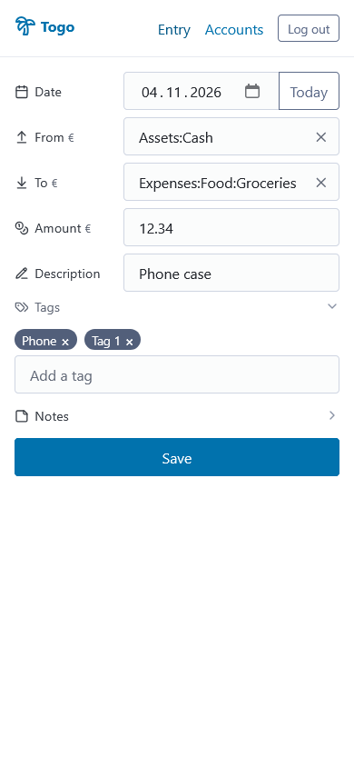
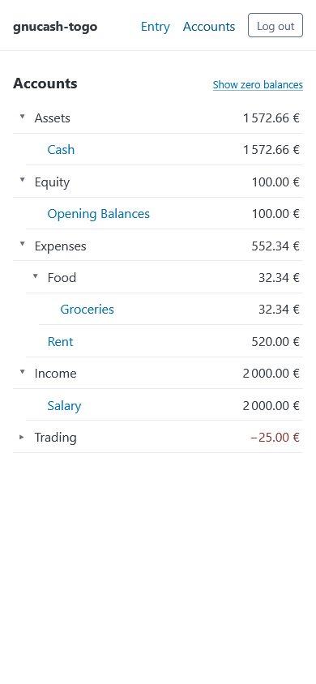
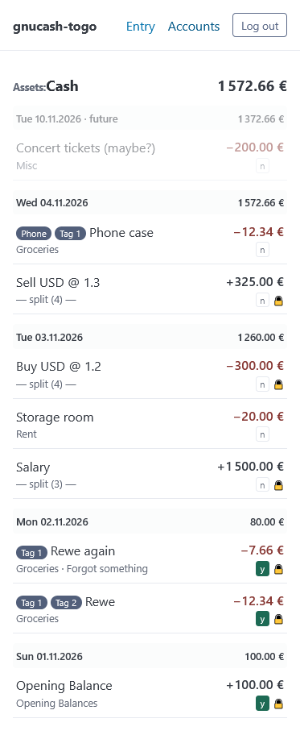

# gnucash-togo

A phone-friendly web front end for a GnuCash book stored in PostgreSQL.
Enter transactions on the go, browse accounts and balances, fix mistakes.

| Entry | Accounts | Register |
|:---:|:---:|:---:|
|  |  |  |

While GnuCash desktop has the book open, writes are refused.

## Deploy

The app runs next to an existing PostgreSQL stack that holds the book. [`compose.yaml`](compose.yaml) has two
services:

- `db-init` runs once per start. It creates the app's database role if it's missing, sets its password and grants
  only what the app needs ([ADR-0006](../docs/adr/0006-passthrough-auth-least-privilege-role.md)). Running it again
  is safe.
- `app` starts after `db-init` succeeds and listens on port 8302.

1. Find the PostgreSQL stack's network: `docker network ls`.
2. In OMV, create a compose file from [`compose.yaml`](compose.yaml) and set these variables in its `.env`:

   | Variable | Meaning |
   |---|---|
   | `GNUCASH_DB_NETWORK` | The network from step 1 |
   | `GNUCASH_DB_HOST` | The PostgreSQL service's name on that network |
   | `GNUCASH_DB_PORT` | Optional, default `5432` |
   | `GNUCASH_DB_NAME` | The book's database |
   | `GNUCASH_DB_ADMIN_USER`, `GNUCASH_DB_ADMIN_PASSWORD` | A superuser (or the book's owner), used only by `db-init` |
   | `TOGO_DB_USER` | Optional, the app's role, default `togo` |
   | `TOGO_DB_PASSWORD` | The app role's password: you log in to the app with this user and password |
   | `TZ` | Optional, default `Europe/Berlin`. Decides what "today" and "future" mean |

3. Start it. Open `http://<server>:8302` on the phone, log in, and add it to the home screen.

The image is published to `ghcr.io/imolcean/gnucash-togo`. If the package is private, log the server in
once with `docker login ghcr.io` and a token that can read packages.

The compose file uses `latest`, the newest build of `master` that passed the tests, and pulls it on every start.
To upgrade, restart the stack. To stay on a version, replace `latest` with a `sha-<short>` or `X.Y.Z` tag.
Sessions live in memory, so everyone logs in again after a restart.

## Releases

The workflow [`gnucash-togo-image.yml`](../.github/workflows/gnucash-togo-image.yml) runs every test and then
builds the image:

| Event | Image tags |
|---|---|
| Push to `master` touching `gnucash-book`, `gnucash-togo`, `pom.xml` or `.mvn` | `latest`, `sha-<short>` |
| Git tag `gnucash-togo/vX.Y.Z` | `X.Y.Z` |
| Pull request | built, not pushed |

Release tags are optional: they give a build a name to go back to. To make one, tag a commit on `master` and
push the tag:

```powershell
git tag gnucash-togo/v1.0.0
git push origin gnucash-togo/v1.0.0
```

## Run locally

From the repository root:

```powershell
$env:GNUCASH_DB_HOST = "localhost"
$env:GNUCASH_DB_NAME = "gnucash"
.\mvnw install -DskipTests
.\mvnw -pl gnucash-togo spring-boot:run
```

Open http://localhost:8080 and log in with a PostgreSQL user that has the ADR-0006 grants.

To build the image locally, also from the repository root:

```powershell
docker build -f gnucash-togo/Dockerfile -t gnucash-togo .
```

## Credits

The app icon adds a palm tree to the GnuCash application icon
(`data/pixmaps/hicolor/scalable/apps/gnucash-icon.svg` in the [GnuCash](https://github.com/Gnucash/gnucash)
source, GPL). The generator is in [`prototypes/icon`](prototypes/icon).
